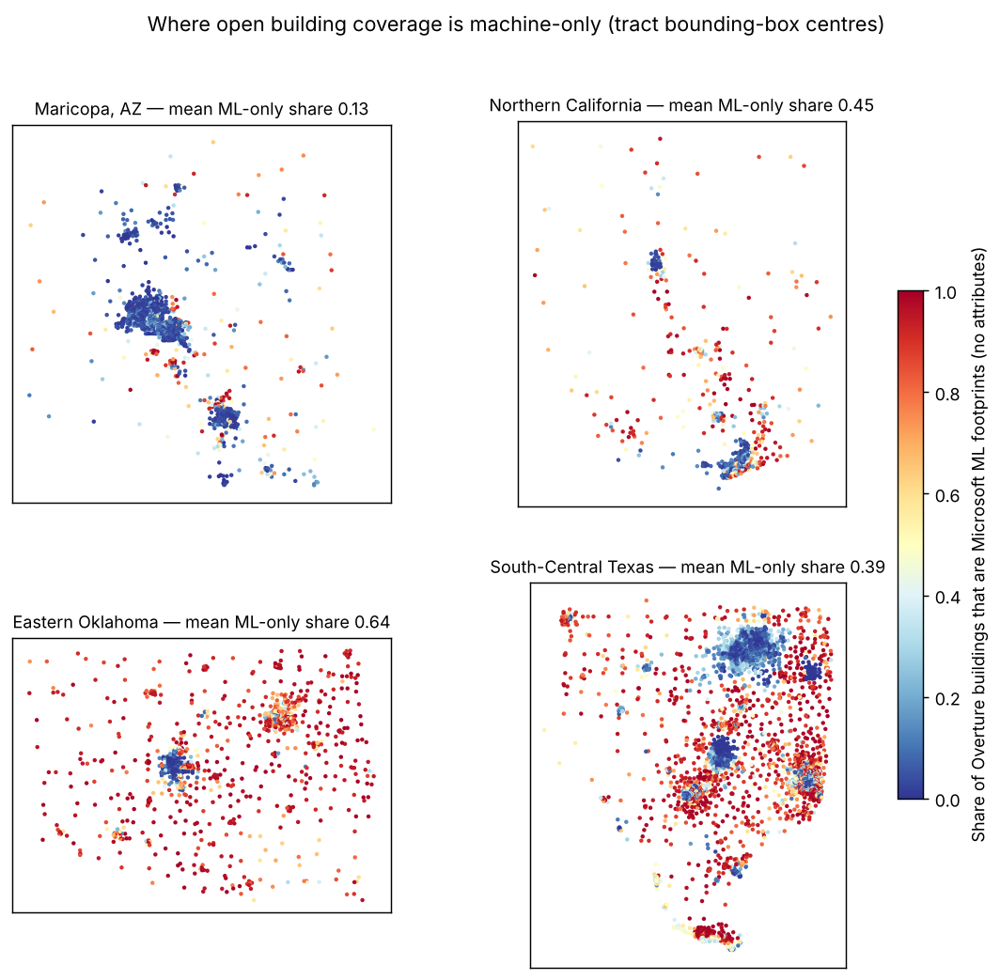
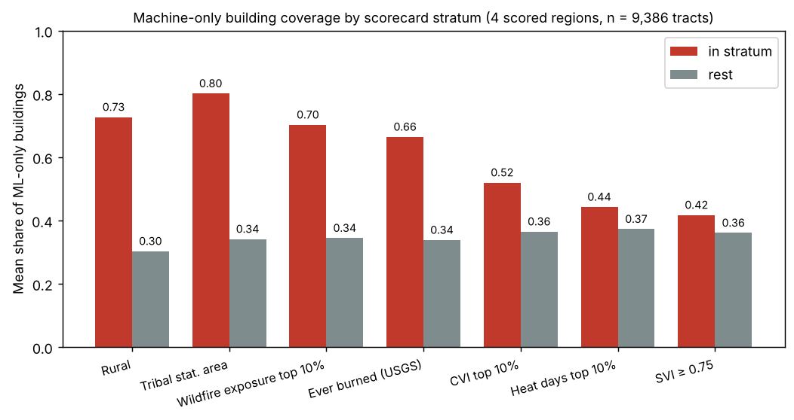
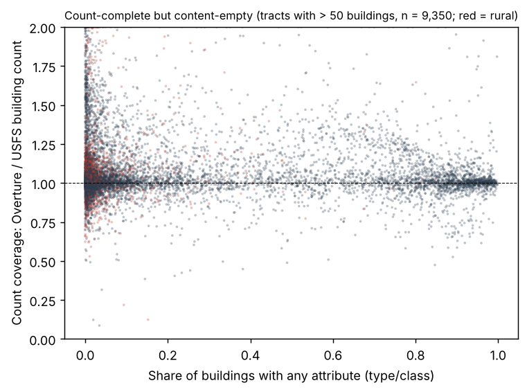
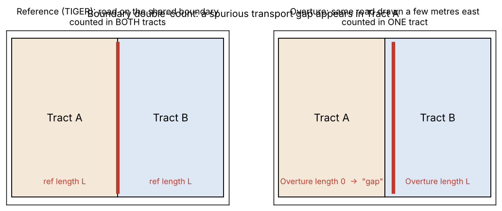
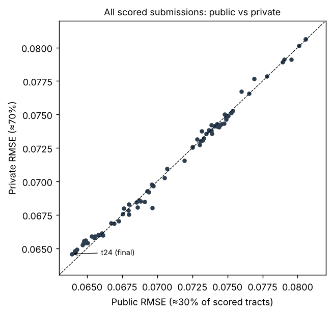
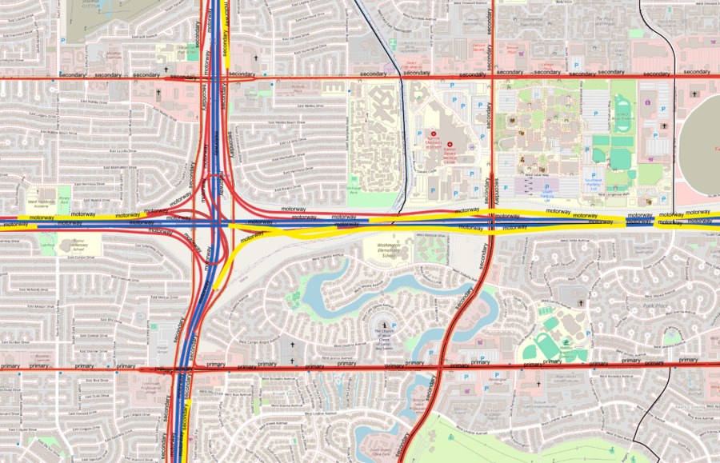
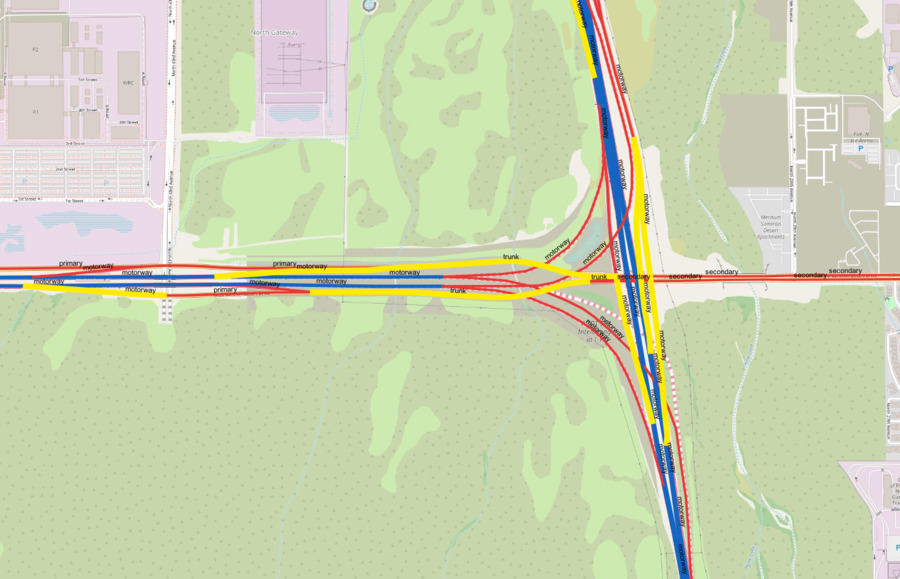
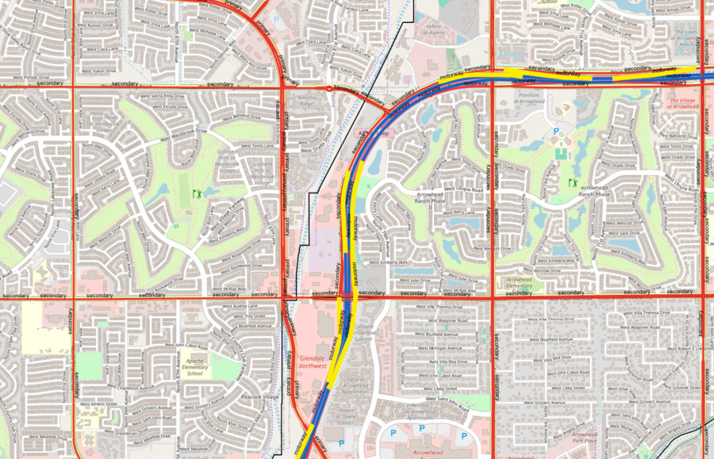

# Counted but not known

**Machine-only map coverage in rural, tribal and wildfire-exposed tracts, two measurement artifacts in the coverage-gap metric, and a reproducible methodology.** Bias Bounty: Mapping Equity Challenge — Zindi username **dodo25** — associated submission **pwM1ZRTe** (public 0.06391, private 0.06457) — 1 November 2026. Full PDF: [`writeup_dodo25.pdf`](writeup_dodo25.pdf).


# Executive summary

This document is submitted for both special prizes. **Part I** is the Bias Discovery. **Part II** is the methodology documentation for the leaderboard model. Everything in both parts is computed from the challenge bundle only; no TIGER, Microsoft, HIFLD or CBP data was used anywhere, including in the discovery analysis.

**Finding 1 — Counted but not known.** Across the four scored regions (9,386 tracts, 38.8 million residents), the Overture building layer in rural, tribal and wildfire-exposed tracts is *complete by count and empty by content*. In rural tracts **73%** of buildings are Microsoft machine-detected footprints carrying no type, no class and no corroboration from any other source; in urban tracts the figure is 30%. In tribal statistical areas it is **80%**, and in the top wildfire-exposure decile **70%**. Only **4%** of rural buildings carry any attribute at all, against 30% elsewhere. The automated scorecard cannot see this: its building metric counts footprints, and a count cannot tell a typed, corroborated inventory from a layer of anonymous polygons. In the 1,816 tracts where more than 90% of buildings are machine-only, footprint counts agree with an independent footprint count to a median ratio of 1.01 — the same as everywhere else — while attribute coverage is a median 0.6%. **7.0 million people** live in those tracts; 46% of them are rural, 23% tribal, 24% in the top wildfire decile. We tested the pattern against the hidden reference through the leaderboard: the organiser's composite gap is itself *higher* where buildings are machine-only (a probe raising predicted gaps in those tracts improved RMSE from 0.0790 to 0.0765; the opposite probe worsened it to 0.0806), so the count metric points the right way but measures only a small part of the problem — a composite gap of a few hundredths against a usable-content gap of 0.96 in rural tracts. For evacuation planning, shelter identification and post-event damage assessment, a footprint without a type is not coverage. The effect sizes (Cohen's d 1.0–1.5) are as large as or larger than the rural–urban disparity in the score itself (d ≈ 1.05 on our predictions).

**Finding 2 — A boundary double-count inflates rural and tribal transport gaps.** Tract boundaries follow highways. A reference road on a shared boundary is counted in both tracts; Overture's slightly offset copy falls in one. The neighbour shows a transport gap that does not exist. The artifact averages **+0.066** on the transport component, is **1.81× larger in rural** and **1.32× larger in tribal** tracts, and explains roughly **30% of the rural–urban difference** in mean coverage gap. Part of the rural disparity the scorecard reports is measurement, not mapping.

**Finding 3 — Ramps.** Overture classes interchange ramps as `motorway`/`trunk`; TIGER codes them S1630, outside the reference. Counting ramps hides small real gaps, 3.7× more so in rural tracts. A QGIS inspection of 200 Maricopa segments documents the pattern.

**Methodology.** With no training labels, we reconstructed the transport component deterministically from Overture geometry following the published methodology, used interpretable proxies for the building and POI components, and calibrated with a leaderboard-probe calculus whose predictions matched realised scores to within 0.00015 on the last four re-fits. The public score went from 0.0790 to **0.0639** (private 0.0646). Edge cases (zero-population, water-dominated, data-sparse and transport-undefined tracts) are tabulated in Section 11. One honest caveat: the final leaderboard entry for dodo25 shows an early submission because of a selection error on our side; the method's actual final scores are those of `pwM1ZRTe`, listed above and visible on the submissions page.

---

# PART I — BIAS DISCOVERY

# 1. Finding 1: Counted but not known

## 1.1 What the scorecard measures, and what it cannot

The challenge's building component compares the number of Overture building footprints in a tract with a reference count. The automated scorecard then reports disparity ratios of the resulting score across strata (rural/urban, tribal, SVI, CVI, hazard). Two things are invisible to this design:

1. **Content.** A count does not know whether a footprint is a house, a school, a fire station, a barn or a carport. Overture carries this as `subtype`/`class`. Footprints that come from machine detection carry none of it.
2. **Provenance.** Overture's building theme merges four sources: OpenStreetMap, Microsoft ML Buildings, Esri Community Maps and Google Open Buildings, and it carries a Microsoft footprint only where OpenStreetMap has no building (in the data, 2% of Microsoft footprints are matched by a second source, against 72% of OpenStreetMap buildings). The share of Microsoft footprints in a tract is therefore a direct measure of how much of its building stock no person has ever mapped: no name, no type, no second source confirming it exists. A count treats such a footprint and a surveyed, typed, community-verified building as the same unit.

The scorecard therefore measures *how many* features are missing and cannot measure that the features which are present are *empty*. We measured how large and how unevenly distributed that second gap is, and then checked against the hidden reference (Section 1.4) how it relates to the gap the scorecard does measure.

## 1.2 Measures and data

All measures come from the provided per-tract building aggregates (`<region>-bldg-tract.parquet`: `src`, `subtype`, `class`, `n`, `n_multisrc`), the POI table (`<region>-pois-tract.parquet`: `cat`, `confidence`, `src`), the tract table (`pop_total`, `ur_class`) and the strata table (`tribal_statistical`, `usfs_Exposure_mean`, `usgs_wildfire_ever`, `svi_overall`, `cvi_overall`, `epht_heat_days_summer`, `usfs_BuildingCount_sum`). For each tract:

- **ML-only share** = buildings with `src = "Microsoft ML Buildings"` / all buildings. In the data, 100% of these footprints have null `subtype`, and 2% are corroborated by a second source (`n_multisrc`), against 72% of OpenStreetMap buildings.
- **Attribute share** = buildings with non-null `subtype` / all buildings.
- **Multi-source share** = `n_multisrc` / `n`.
- **Count coverage** = Overture buildings / `usfs_BuildingCount_sum` (a raster-derived building count provided in the strata table, used only as a count yardstick).
- POI measures: share of POIs whose `src` is `meta` (Facebook business pages), mean `confidence`, share with `confidence < 0.5`.

Groups are the scorecard's own strata: Rural (`ur_class`), Tribal statistical area (`tribal_statistical > 0`), wildfire exposure top decile (`usfs_Exposure_mean`), ever burned (`usgs_wildfire_ever`), SVI ≥ 0.75, CVI top decile, summer heat days top decile. Statistics are Welch t-tests and Cohen's d; every |t| above 5 corresponds to p < 10⁻⁶. The full table is `results/quality_gap_table.csv` (42 rows: six measures by seven strata).

## 1.3 Results



**Table 1.** Building-layer content by scorecard stratum (4 scored regions, n = 9,386 tracts).

| Stratum | n | ML-only share: in / rest | ratio | d | Attribute share: in / rest | d | Multi-source share: in / rest | d |
|---|---:|---|---:|---:|---|---:|---|---:|
| **Rural** | 1,712 | **0.727** / 0.303 | 2.40 | **1.26** | **0.041** / 0.296 | −1.00 | **0.141** / 0.529 | −1.44 |
| **Tribal statistical area** | 794 | **0.801** / 0.341 | 2.35 | **1.46** | 0.067 / 0.267 | −0.78 | 0.124 / 0.489 | −1.34 |
| **Wildfire exposure top 10%** | 939 | **0.702** / 0.344 | 2.04 | **1.01** | 0.047 / 0.272 | −0.88 | 0.154 / 0.492 | −1.21 |
| Ever burned (USGS) | 1,211 | 0.664 / 0.338 | 1.96 | 0.90 | 0.072 / 0.276 | −0.75 | 0.208 / 0.495 | −0.94 |
| CVI top 10% | 938 | 0.520 / 0.365 | 1.43 | 0.41 | 0.069 / 0.270 | −0.76 | 0.378 / 0.467 | −0.26 |
| Heat days top 10% | 997 | 0.443 / 0.373 | 1.19 | 0.18 | 0.097 / 0.268 | −0.64 | 0.515 / 0.451 | +0.18 |
| SVI ≥ 0.75 | 3,233 | 0.417 / 0.361 | 1.16 | 0.15 | 0.210 / 0.270 | −0.18 | 0.440 / 0.468 | −0.08 |



**Table 2.** The same measures by region and stratum, with resident population.

| Region | Stratum | Tracts | ML-only | Attribute | Multi-source | Population |
|---|---|---:|---:|---:|---:|---:|
| Eastern Oklahoma | Tribal statistical area | 792 | 0.80 | 0.067 | 0.12 | 2,627,624 |
| Eastern Oklahoma | Rural | 411 | 0.87 | 0.025 | 0.06 | 1,326,111 |
| Eastern Oklahoma | Wildfire top 10% | 161 | 0.90 | 0.022 | 0.05 | 528,047 |
| South-Central Texas | Rural | 991 | 0.73 | 0.035 | 0.14 | 3,622,198 |
| South-Central Texas | Wildfire top 10% | 527 | 0.75 | 0.026 | 0.13 | 1,940,153 |
| Northern California | Rural | 147 | 0.73 | 0.047 | 0.16 | 497,511 |
| Northern California | Wildfire top 10% | 97 | 0.75 | 0.045 | 0.16 | 340,174 |
| Maricopa, AZ | Rural | 163 | 0.37 | 0.115 | 0.32 | 536,056 |
| *All four regions* | *Rural AND wildfire top 10%* | 836 | 0.73 | 0.037 | — | 2,910,304 |
| *All four regions* | *Tribal AND rural* | 366 | 0.87 | 0.026 | — | 1,189,189 |

Regional means of the ML-only share: Eastern Oklahoma 0.64, Northern California 0.45, South-Central Texas 0.39, Maricopa 0.13. The pattern is therefore not one region's quirk: it recurs inside every region, and it is strongest where the strata overlap.

**Count-complete, content-empty.** In the 1,816 tracts where more than 90% of buildings are machine-only, the median count coverage (Overture / USFS count) is **1.009**; in all other tracts it is 1.020. A count-based metric sees no difference. In the same 1,816 tracts the median attribute share is **0.006**. Figure 3 shows the two axes against each other.



**No community mapping at all.** In 1,414 tracts (15% of all tracts, 5.37 million residents) fewer than 5% of buildings come from OpenStreetMap. The share of such tracts is 36% among rural tracts versus 10% elsewhere, 37% versus 13% for tribal areas, and 34% versus 13% for the wildfire decile.

**In absolute terms.** Rural tracts contain 5.38 million Overture buildings; **5.16 million (95.9%)** have no type or class. Non-rural tracts contain 12.7 million, of which 73% have none.

## 1.4 What the hidden reference says

A natural objection is that the organiser's building reference (Microsoft's footprint product) shares a producer with these machine-only footprints, so the count-based gap might simply be near zero there and the scorecard would be reporting *good* coverage where content is worst. We tested this directly on the leaderboard rather than assume it. Starting from the transport-only reconstruction `t3` (public RMSE 0.07904, private 0.07911), we submitted the same perturbation with both signs:

| Probe | Change relative to `t3` | Public | Private |
|---|---|---:|---:|
| `t4` | *lower* the predicted gap in proportion to the machine-only share | 0.08057 | 0.08065 |
| `t4b` | *raise* it by the same amount | 0.07781 | 0.07787 |
| `t5` | raise it 2.5× as much | **0.07655** | **0.07658** |

The hidden reference moves the other way from the objection: tracts whose buildings are machine-only have a *higher* composite coverage gap, and this was the single most profitable direction of the early phase (0.0790 → 0.0765). The leaderboard cannot separate the building and POI components, so we do not claim which of the two carries the signal. What it establishes is the relationship between the two gaps: the count-based gap the scorecard reports and the content gap it cannot report point the same way, and the second is an order of magnitude larger — a composite score of roughly 0.10 in rural tracts against a usable-content gap of 0.96. The scorecard under-states the problem rather than inverting it. (The near-1.0 count agreement in Figure 3 is between two footprint-derived counts and is shown only to make the count/content contrast visible, not as independent ground truth.)

The final calibrated submission inherits this relationship, and it holds inside both the rural and the urban stratum, so it is not rurality in disguise:

| Machine-only share of buildings | Tracts | Mean calibrated composite gap (`t24`) | rural tracts only | urban tracts only |
|---|---:|---:|---:|---:|
| < 10% | 4,013 | 0.035 | 0.100 | 0.033 |
| 10–50% | 1,893 | 0.054 | 0.082 | 0.049 |
| 50–90% | 1,655 | 0.078 | 0.109 | 0.065 |
| > 90% | 1,816 | 0.101 | 0.125 | 0.080 |

Two tracts with the same composite gap of 0.10, one with 96% typeless footprints and one fully attributed, are identical to the scorecard. And because the building count can be raised toward a footprint reference by ingesting more detector output, the building component can be closed in these tracts without a single person ever looking at them. The scorecard's signal and the mapping need point the same way today; the metric can nevertheless be satisfied by the wrong fix.

## 1.5 The POI layer shows the same provenance pattern

The places layer is not count-deficient in rural tracts either; its *sources* differ. In rural tracts 75% of POIs come from `meta` (Facebook business pages) against 61% elsewhere (d = 1.49); in the wildfire decile 76% versus 63% (d = 1.36). Mean confidence is lower (0.782 versus 0.816, d = −0.74) and the share of low-confidence records (< 0.5) is higher (14.3% versus 11.1%). Coverage in these tracts therefore rests on self-reported business pages rather than curated or community-verified records. A count of POIs does not reveal this.

## 1.6 Who is affected

- **Rural residents.** 5.98 million people in the four regions live in rural tracts; 5.35 million of them live in tracts where fewer than 10% of buildings carry any attribute.
- **Tribal statistical areas.** 2.64 million residents; 2.17 million in tracts under the same 10% threshold. Eastern Oklahoma's tribal areas (the Cherokee, Choctaw, Chickasaw, Muscogee and Seminole statistical areas) are the largest single affected population, 2.6 million people with 80% machine-only buildings.
- **Wildfire-exposed communities.** 3.33 million residents in the top exposure decile; 2.97 million under the 10% threshold. The overlap of rural and wildfire-exposed tracts holds 2.91 million people with a 73% machine-only share.
- Socio-economic vulnerability on its own (SVI) is only weakly associated with the pattern (d = 0.15). This is a geography-of-contribution gap, not an income gap: it follows where volunteer mappers and commercial data producers do and do not work.

## 1.7 Why it matters for disaster preparedness and climate resilience

The operational uses that the challenge motivates depend on attributes, not on footprints:

- **Evacuation planning** needs to know which footprints are dwellings and how many people a road serves. A tract whose 2,000 footprints are all typeless gives the planner a count of roofs, not of households; barns, carports, pump houses and homes are indistinguishable. In the rural–wildfire overlap, 96% of footprints are in this state.
- **Shelter and critical-facility identification** relies on `school`, `church`, `fire_station`, `hospital` classes. Machine-detected footprints never carry these. In the places layer, the civic categories that do exist in these tracts are disproportionately self-reported pages with lower confidence.
- **Structure triage during a wildfire** (which structures are defensible, which are occupied) and **post-event damage assessment** both start from a typed building inventory. Where the inventory is typeless, assessors fall back to field survey, which is slowest exactly where distances are longest.
- **Heat and climate resilience planning** uses building type to locate manufactured housing and other heat-vulnerable stock. Tracts in the top heat-days decile carry an attribute share of 0.097 against 0.268 elsewhere.

The consequence of the scorecard's blind spot is a policy signal that is too weak rather than wrong: a funder reading a rural composite gap of 0.10 would budget for filling in a tenth of the map, when the task in these tracts is to give a type, a name and a second source to almost every building that is already drawn.

## 1.8 Recommendations

1. **Report attribute coverage alongside count coverage.** Two numbers per tract: footprints relative to reference, and share of footprints with a type/class. The second is computable from the Overture extract alone.
2. **Report provenance with the count.** Where most candidate features originate from the reference's producer, the count comparison is not an independent measurement; publish the community-mapped and multi-source shares next to it so that readers can see how much of the "coverage" is self-agreement between machine products.
3. **Add provenance strata to the bias API.** "Community-mapped share" is a stratum in its own right and, by the sizes above, a more discriminating one than SVI.
4. **Direct mapping effort** at the rural–wildfire and tribal–rural overlaps named in Table 2, where 2.9 and 1.2 million people respectively live under machine-only coverage.

# 2. Finding 2: The boundary double-count artifact

## 2.1 Mechanism



1. Census tract boundaries frequently follow major roads.
2. A reference (TIGER) road lying exactly on a shared boundary intersects the closed polygons of both tracts, so its full length counts in each.
3. Overture represents the same road a few metres off the line, so it falls inside one tract.
4. The neighbouring tract records reference length with no matching Overture length, which is a spurious transport gap.

Evidence from the provided data: **28.9%** of all route-tagged reference highway length in the four regions runs within 8 m of a tract boundary (29.7% for motorways and trunks), so the exposure to this artifact is large. The hidden reference behaves as the mechanism predicts: our reconstruction that counts boundary roads on both sides (8 m / 25 m buffers) is the basis of every scored submission, and the one probe that removed the buffer (`c4`) worsened the public score from 0.0694 to 0.0697 on an otherwise identical file.

## 2.2 Size and who is affected

We computed each transport-defined tract's gap twice: once with the reference measured inside an 8 m buffer of the tract (which counts a boundary road in both neighbours, as the reference does) and once with the reference measured strictly inside the polygon (`L0`). The difference is the artifact. Reference = route-tagged roads without links; numerator = all four Overture classes; defined = strict-inside reference > 100 m (n = 6,707). Full table in `results/bias_artifacts_table.csv`.

| Group | Artifact, in group | Artifact, rest | Ratio | Welch t | p | Cohen's d |
|---|---:|---:|---:|---:|---:|---:|
| **Rural** | 0.099 | 0.055 | **1.81×** | 11.2 | < 10⁻¹⁰ | +0.32 |
| **Tribal statistical area** | 0.084 | 0.064 | **1.32×** | 3.2 | 0.001 | +0.14 |
| High SVI minority (≥ 0.75) | 0.055 | 0.072 | 0.76× | −4.9 | 8·10⁻⁷ | −0.13 |
| High SVI overall | 0.064 | 0.067 | 0.95× | −1.0 | 0.31 | — |

- Across transport-defined tracts the artifact adds a mean of **+0.066** to the transport component, and more than 0.05 in **27%** of them (19% of all tracts).
- Rural and tribal tracts are larger and their boundaries more often follow state and US highways, so the artifact concentrates there.
- Propagated to the composite score (weight 1/3 in defined tracts), it explains about **30% of the rural–urban difference** in mean coverage gap: removing it from our final submission lowers the rural/non-rural ratio from 2.36× to 2.20× (29% of the difference; 30% under `t19`). For tribal tracts it accounts for 13% of the tribal/non-tribal difference.

## 2.3 Recommendation

Assign boundary-coincident reference roads to one tract, or split them 50/50, before computing ratios; and report the transport disparity with and without the correction so that users can separate mapping gaps from measurement effects.

# 3. Finding 3: Ramps and link roads

Overture classes ramps as `motorway`/`trunk` with `subclass = link`; TIGER codes them S1630, outside the S1100/S1200 reference. Counting ramps on the Overture side hides real gaps in interchange-heavy tracts.

- The effect is small on average (+0.004 on the transport component) but **3.7× larger in rural tracts** (t = 10.6), where a single interchange is a large share of named-highway length, and smaller in high-minority urban tracts (0.51×).
- As a share of named-highway length, ramps are a larger fraction in high-SVI-minority tracts (9.2% versus 6.9%, p < 10⁻¹⁰), so those tracts' transport scores rest more on ramp length.
- A field inspection in QGIS of the 200 longest untagged `motorway`/`trunk` segments in Maricopa (Appendix) found interchange ramps, collector–distributor lanes, frontage/service connectors and untagged second carriageways: exactly where Overture's classes and route tags diverge from the official highway definition.

Recommendation: exclude `subclass = link` from the numerator so that it matches TIGER's exclusion of S1630.

# 4. Reproducibility of Part I

Every number in Part I is produced by `code/quality_gap.py` (Finding 1; reads the bundle's `bldg-tract`, `pois-tract`, `tracts`, `strata` and `acs` parquet files, writes `results/quality_gap_table.csv` and the three figures) and `code/bias_artifacts.py` (Findings 2–3; reads `data/rb3.parquet`, writes `results/bias_artifacts_table.csv`). Both run in a few minutes on a laptop with pandas, numpy and matplotlib. No external data, no network access, no stochastic step.

---

# PART II — METHODOLOGY DOCUMENTATION

# 5. Data and rules compliance

- **Inputs** are the challenge bundle only: `*-tracts`, `*-strata` (227 columns), `*-acs`; Overture roads, buildings and places as distributed; and aggregates of these that we computed ourselves (per-tract road lengths with boundary buffers, building counts by source, POI counts by category).
- **Not used:** TIGER/Line, Microsoft Building Footprints, HIFLD, County Business Patterns, or any copy of them, for scoring or for the discovery analysis.
- **Tools:** Python 3, pandas, numpy, DuckDB (spatial extension). Geometry ran on Kaggle CPU kernels in EPSG:5070 (CONUS Albers, equal-area, metres).
- **Determinism:** no step is stochastic; every intermediate file reproduces exactly.

# 6. Structure of the reference score

From the published methodology, for tract *i* with building gap B, POI gap P and transport gap T:

$$ y_i = \frac{B_i + P_i + m_i\,T_i}{2 + m_i}, \qquad m_i = \mathbb{1}[\text{reference highway length in tract} > 0]. $$

We verified that B and P are almost always defined, so the undefined component is essentially transport. The methodology reports the share of tracts with at least one undefined component as 21% (OK), 37% (CA), 28% (TX) and 55% (AZ); our reconstructed transport-undefined shares are 22%, 39%, 29% and 55%.

# 7. Transport component reconstruction

**Numerator.** Length of `motorway`, `trunk`, `primary` and `secondary` segments inside the tract (`ST_Length(ST_Intersection(road, tract))`, column `L0`).

**Reference-side proxy.** TIGER S1100/S1200 are numbered Interstate, US and State routes. We identify them in Overture through `routes[].network`:

```
^US:I(:.*)?$ | ^US:US(:(Business|Alternate|Spur|Bypass|Truck))?$
| ^US:(AZ|CA|OK|TX|NM)(:(Loop|Spur|Business|Beltway|Park))?$
| ^US:(OK:Turnpike|TX:Toll|TX:NTTA|TX:Harris:HCTRA)$   (+ US:TX:FM / RM)
```

Ramps (`subclass = link`) are excluded, because TIGER codes them S1630.

**Boundary buffers.** The reference proxy uses the length inside the tract polygon buffered by 8 m (all classes) and 25 m (`motorway`, `trunk`), i.e. `ST_Buffer(tract, 8)` and `ST_Buffer(tract, 25)`; columns `L8`, `L25`. `Lbd8` is the length within 8 m of the boundary itself, used in Section 2.

**Gap and definedness.** T = clip(1 − Overture / reference, 0, 1); m = 1 when the reference proxy exceeds 100 m. The threshold is insensitive: 50 m or 250 m changes only 13 and 40 tracts.

**Overture tagging gap.** Rescuing untagged mainline carriageways identified in the QGIS inspection changes only 94 tracts (about 1 Mm against 52 Mm of tagged core).

# 8. Building and POI proxies

- **Building:** Overture counts by source (OpenStreetMap, Microsoft ML, Google, Esri); counts without small structures (< 40 m²) against `usfs_BuildingCount_sum`; area per structure.
- **POI:** places per capita; source shares and confidence; facility categories (fire, EMS, schools; hospitals excluded, as the methodology states); business-type places relative to housing units.
- **Neighbourhood:** 8-nearest-tract means of the prediction within each region (tract bbox centres, longitude scaled by cos latitude). This became one of the strongest directions, especially for transport-undefined tracts (Section 11).

# 9. Leaderboard-probe calculus

Let *s* be a scored submission with public MSE M₀ and *u* a perturbation vector. Then

$$ \mathrm{MSE}(s + a u) = M_0 + 2a\,c + a^2 q, \qquad q = \overline{u^2}, \quad c = \overline{u\,(s - y)}. $$

*q* is computed locally; one scored probe at a = 1 gives c = (M₁ − M₀ − q)/2 and the optimal step a* = −c/q. For many directions we solve Qa = −c with the local Gram matrix Q; information from earlier probes carries over to a new base exactly through c_new = c_old + ⟨u, Δbase⟩.

## 9.1 Global re-fit with a noise model

Every scored file is a vector with one known inner product against the hidden residual. We re-fit the best combination of all scored vectors at once:

$$ a^{*} = -(G + \lambda\,\mathrm{diag}(\sigma_k^2))^{-1} g, $$

where σ_k is estimated by leave-one-out prediction of each scored submission from all the others, and λ is chosen by simulation so that the *expected realised* gain is maximised rather than the in-sample gain. Late probes that were designed to be orthogonal to the existing span (region × definedness constants, region stretch, rural indicators) were given their measured, smaller noise.

## 9.2 Quality control that changed results

- **Leave-one-out consistency revealed two mislabeled batches** (scores attached to the wrong files: b1/b2/b4, and a1/a2). With the corrected mapping the joint prediction error for `t14` fell from 0.00102 to 0.00021, and the re-fit `t18` was predicted at 0.06601 and scored 0.06599.
- **Prediction accuracy of the calculus on the last four re-fits:** t21 predicted 0.06486 → scored 0.06490; t22 0.06464 → 0.06476; t23 0.06408 → 0.06415; t24 0.06390 → 0.06391.
- **Public/private agreement of the probes.** Across all 85 scored files the private score differs from the public score by a median 0.00023 (90th percentile 0.0007; full list in `results/all_submissions_public_private.csv`), and every sign reported in this document (t4/t4b/t5, c4, k6) is the same on both boards.
- **Eastern WA is not scored.** A probe that changed only Eastern WA tracts left the public score unchanged to nine digits; all inner products are therefore computed on the four scored regions.
- **Public/private.** The public leaderboard is a random ~30% sample. We shrink directions in proportion to their estimated noise; Section 9.3 audits how well that worked.

## 9.3 Where the calculus overfits the public split

With the private scores visible after the close, the method can be audited. Across all 85 scored submissions the public and private RMSE correlate at 0.9986. The structural improvements (`t3` → `t18`) transferred almost one-for-one: `t18` scored 0.06599 public and 0.06600 private. The probe-driven re-fits after it did not transfer fully: the public–private difference grows from +0.00001 (`t18`) to +0.00019 (`t19`), +0.00025 (`t20`), +0.00050 (`t21`) and +0.00066 (`t22`–`t24`). Of the 0.0021 public gain from `t18` to `t24`, about 0.0014 was real and 0.0007 was fit to the public sample. The noise model anticipated the direction but underestimated the size; a λ two to three times larger would have been the better choice for the private board. `t24` is still the best private submission of the 85 (0.06457), so the overfit reduced the gain rather than reversing it. We report this because a probe method that cannot say where it overfits is not documented.



# 10. Results (RMSE on `coverage_gap_score`)

| Submission | Content | Public | Private |
|---|---|---:|---:|
| `t3` | transport reconstruction with 8/25 m boundary buffers | 0.07904 | 0.07911 |
| `t5` | + machine-only-share direction (Section 1.4) | 0.07655 | 0.07658 |
| `t7`–`t9b` | + source-mix and per-capita POI/building directions | 0.07430 | 0.07411 |
| `t10`–`t13` | + structural building (`usfs`), TX FM roads, denominator weighting | 0.07251 | 0.07257 |
| `t14` | + primary/secondary routed roads in reference (largest single direction) | 0.06941 | 0.06922 |
| `t15`–`t17` | + buffer and reference-scale calibration by region | 0.06792 | 0.06782 |
| `t18` | global re-fit, corrected labels | 0.06599 | 0.06600 |
| `t19` | + county/kNN/tail/facility probes | 0.06581 | 0.06601 |
| `t20` | noise-weighted re-fit over all scored vectors | 0.06552 | 0.06577 |
| `t21`–`t22` | re-fits including kNN probes | 0.06476 | 0.06542 |
| `t23` | + region × definedness constant probes | 0.06415 | 0.06481 |
| **`t24` (`pwM1ZRTe`)** | + rural and stretch probes | **0.06391** | **0.06457** |

Directions that did not help, reported for completeness: Texas FM roads added to the reference alone; rescaling building/POI corrections by 1/(2+m) (the opposite sign was optimal); population-based facility-absence indicators (optimal weight ≈ 0); county-level POI-per-capita gap (negative weight); kNN smoothing applied to transport-defined tracts (optimal weight ≈ 0, probe `k6`).

**Leaderboard caveat.** The two files marked as final on the submissions page were set on 11 October and never updated, so the closing leaderboard shows dodo25 at 0.0795 / 0.0791. The method's final file is `pwM1ZRTe` (0.06391 public, 0.06457 private), which the judges can verify on the submissions page. We state this plainly rather than let the writeup disagree with the board.

# 11. Edge cases and alternative weightings

The prize text asks how zero-population, water-dominated and data-sparse tracts were handled. The table gives their counts in the four scored regions and the mean prediction of `t24` for each (overall mean 0.059).

| Edge case | Definition | Tracts | Mean prediction | Handling |
|---|---|---:|---:|---|
| Zero population | `pop_total = 0` | 33 | 0.145 | Per-capita ratios are undefined. In code a zero or missing denominator is clipped to 1 and an undefined ratio takes its neutral value (gap contribution 0), so these tracts are predicted from the transport reconstruction, the building count against the USFS count, and the 8-NN neighbourhood mean. They receive the highest mean prediction; we regard this as a known weakness rather than a feature, since the reference itself is least meaningful where nobody lives. |
| Near-zero population | `pop_total < 100` | 72 | 0.093 | Same clipping. Small denominators are the main reason these predictions sit above average; accepted because the tracts are few and contribute little to RMSE. |
| Zero housing units | ACS `housing_units = 0` | 87 | 0.098 | Housing-unit ratios take their neutral value; building proxies use `usfs_BuildingCount_sum` instead. |
| Water-dominated | land area < 50% of tract area (`ALAND` / `area_m2_calc`) | 50 | 0.114 | A land-area density direction (`g2_bld_dens_aland`) and a water-share direction (`g4_water_share`) were prepared but never scored, so these tracts receive no special treatment beyond the neighbourhood mean. Listed as an open item. |
| No Overture buildings | `n = 0` | 9 | 0.097 | Building ratios undefined; prediction from transport and neighbourhood. |
| Data-sparse | < 20 buildings or no POIs | 12 / 7 | 0.105 / 0.097 | Ratios computed with clipped denominators; the neighbourhood term supplies most of the signal. |
| USFS count = 0 | `usfs_BuildingCount_sum = 0` | 9 | 0.097 | Building direction contributes zero. |
| Transport undefined | reference proxy < 100 m | 2,679 | — | Score structure (B + P)/2; 8-NN smoothing within region with optimal weight 0.68 on this subset (probe `k4`). |
| Bounds | — | all | — | Predictions clipped to [0, 1]. An earlier 0.01 floor was removed after a probe showed floored tracts were under-predicted. |
| Eastern WA | not scored | 408 | — | Predicted for completeness; excluded from all inner products. |

**Alternative weightings tested.** Weighting building/POI directions by each tract's actual 1/(2+m) share versus a uniform weight: uniform was better (Section 10), which suggests the organiser's B and P vary more in transport-defined tracts. Region-specific reference scales (`e1`, `e2`, `f1`–`f3`) were kept; a county-level POI direction was rejected.

# 12. Code map and how to reproduce

Repository: `github.com/tdogukan470-jpg/zindi-bias-bounty-dodo25` (public).

| Path | Purpose |
|---|---|
| `data/rb3.parquet` | Output of the geometry step: per-(tract, class, route-flag, subclass) lengths `L0`/`L8`/`L25`/`Lbd8`, computed with DuckDB spatial in EPSG:5070 |
| `data/roadfeat2.parquet` | Per-tract road features derived from `rb3` |
| `code/routes4.py` | Route-tag regex over `routes[].network` |
| `code/feat.py`, `code/feat_new.py` | Per-tract Overture building/POI aggregates, strata/ACS joins, kNN coordinates |
| `code/cands.py` | Candidate probe directions |
| `code/probe_solve.py` | Quadratic probe solver, ridge joint fit |
| `code/global_refit.py`, `code/scores.py` | Leave-one-out noise model, noise-weighted global re-fit; table of all scored submissions |
| `code/quality_gap.py` | Part I, Finding 1: tables and figures |
| `code/bias_artifacts.py` | Part I, Findings 2–3: `results/bias_artifacts_table.csv` |
| `code/leaderboard_audit.py` | Section 9.3: public/private audit, `results/all_submissions_public_private.csv`, `figs/fig_public_private.png` |
| `results/` | `quality_gap_table.csv`, `bias_artifacts_table.csv`, `all_submissions_public_private.csv`, `bias_table_detail.csv` |
| `submissions/` | Scored files `t18`–`t24` |

Order of execution: `routes4.py` → `feat.py` / `feat_new.py` → `cands.py` → `probe_solve.py` / `global_refit.py` → submission CSV. Part I scripts are independent of the model and need only the bundle.

# Appendix — QGIS field inspection (Maricopa)

The 200 longest untagged `motorway`/`trunk` segments were each rendered over the OpenStreetMap basemap with the Overture road layer styled by class (OpenStreetMap basemap © OpenStreetMap contributors). Four representative cases follow.







